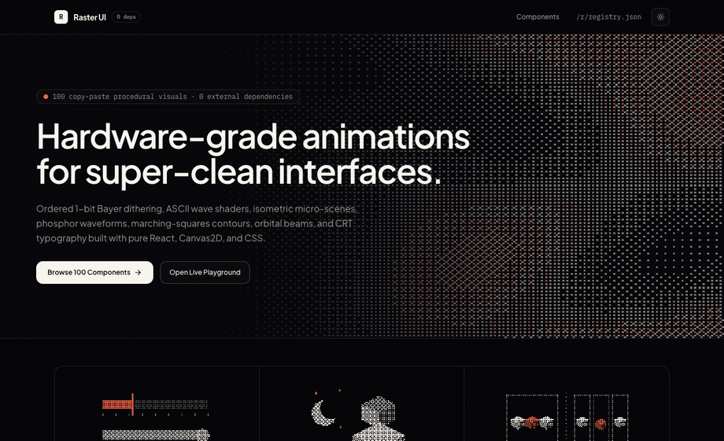
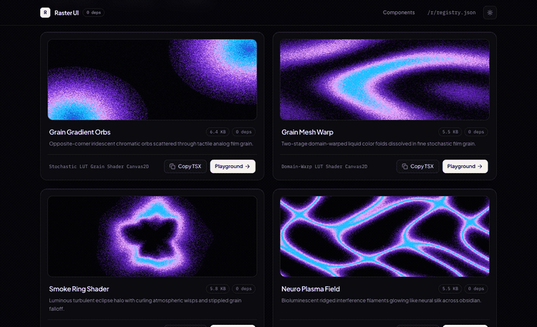
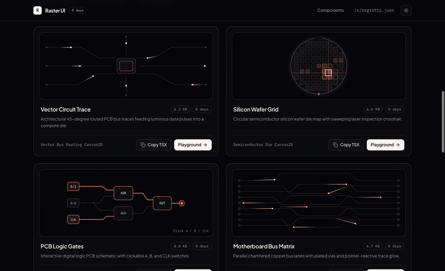
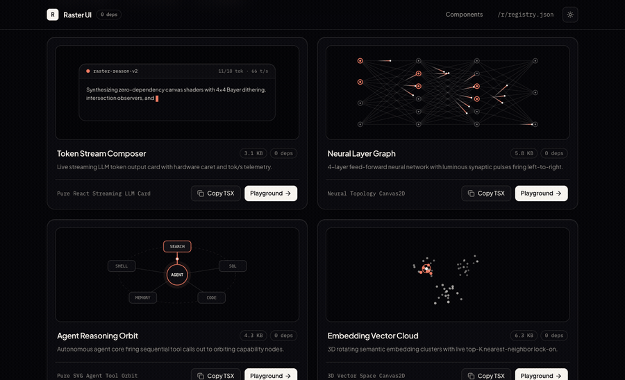
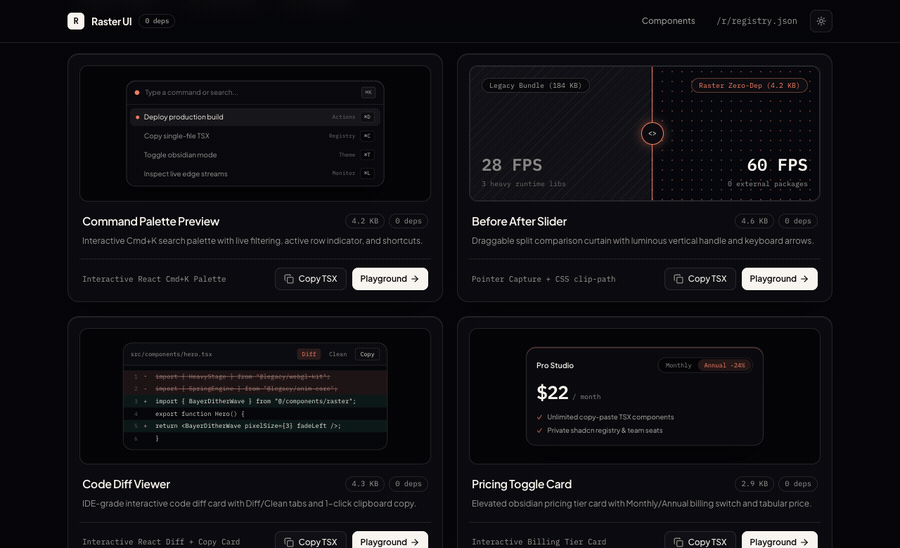

<div align="center">

# Raster UI

**100 zero-dependency animated procedural shaders, circuits, data streams, 1-bit isometric scenes, and dark-mode UI components for React and Next.js.**

[](#complete-100-component-catalog)
[](#visual-families-overview)
[](#design-principles)
[](#installing-any-component-via-shadcn-cli)

<br />



</div>

---

## Live Visual Showcase

Every preview below is recorded directly from the running **Raster UI** app at 60 FPS with zero WebGL frameworks, zero Three.js, zero GSAP, and zero Framer Motion.

### Shaders & Grain (Paper-Style Stochastic LUT Shaders)

Opposite-corner chromatic orbs, domain-warped liquid folds, turbulent smoke rings, bioluminescent neural filaments, solar eclipses, keynote horizons, crystalline Voronoi glass, and optical moire rings rendered with screen-locked analog film grain and zero browser WebGL context limits.



### Circuits & Silicon + Data Flow & Streams

45-degree routed PCB traces, semiconductor silicon wafer inspection maps, clickable digital logic gate schematics (`A`, `B`, `CLK`), multi-lane copper buses, animated cubic-Bezier data beam hubs, optical fiber ribbons, filtering prisms, and regional cluster routing.



### AI & Agents + Security & Crypto

Live LLM token streaming cards, feed-forward neural layer graphs, autonomous agent tool-calling orbits, 3D semantic embedding vector clouds, concentric cipher lock vaults, zero-trust WAF packet deflection, immutable hash-chain ledgers, and optical iris scanners.



### Website Essentials + Editorial & Craft

Interactive `Cmd+K` search palettes, draggable before/after comparison curtains, toggleable code diff cards, monthly/annual pricing cards, calligraphic SVG signature reveals, clickable 3D fanned card decks, glowing vertical changelog timelines, and pure-SVG gooey liquid metaballs.



---

## Design Principles

- **Zero External Runtime Dependencies:** Every component inside [`src/registry/components/`](src/registry/components) imports **only** `"react"` and stays under `12 KB` so you can copy one file into any React or Next.js project without bundle bloat.
- **No WebGL Context Limits:** Procedural grain shaders use precomputed 256-step RGB LUTs and triangular spatial noise on pure Canvas2D `ImageData`, letting dozens of shaders render cleanly on one page without hitting Chromium's 16-context WebGL ceiling.
- **Accessible & Battery Friendly:** Every animated component respects `prefers-reduced-motion: reduce` and pauses automatically via `IntersectionObserver` when scrolled off-screen.
- **Live Playground & 5 Palette Presets:** Switch between **Terracotta**, **Prism** (Violet / Cyan / Cobalt), **Cobalt**, **Mono**, and **Emerald** palettes, tweak animation speed and grain/pixel scale, and copy usage or full TSX source on `/components/[slug]`.

---

## Local Development

```bash
pnpm install
pnpm dev
```

Open `http://localhost:3001` to browse all **100 live components** across **16 visual families**, test props in the interactive playground, copy standalone `.tsx` files, or inspect the `shadcn` registry index at `/r/registry.json`.

### Running Tests & Production Build

```bash
pnpm typecheck
pnpm test
pnpm build
```

---

## Installing Any Component via shadcn CLI

Every component is served as a `shadcn`-compatible `registry:ui` JSON item at `/r/[slug].json`:

```bash
# Shaders & Grain
npx shadcn@latest add http://localhost:3001/r/grain-gradient-orbs.json
npx shadcn@latest add http://localhost:3001/r/grain-eclipse-crescent.json

# Circuits & Data Flow
npx shadcn@latest add http://localhost:3001/r/vector-circuit-trace.json
npx shadcn@latest add http://localhost:3001/r/pcb-logic-gates.json
npx shadcn@latest add http://localhost:3001/r/data-beam-hub.json

# Website Essentials & Editorial
npx shadcn@latest add http://localhost:3001/r/command-palette-preview.json
npx shadcn@latest add http://localhost:3001/r/before-after-slider.json
npx shadcn@latest add http://localhost:3001/r/liquid-metaball-blob.json
```

Replace `http://localhost:3001` with your deployed domain once hosted so any project can install components directly over HTTPS.

---

## Visual Families Overview

| Visual Family | Count | Focus |
| :--- | :---: | :--- |
| [Shaders & Grain](#shaders--grain-13) | **13** | Paper-style stochastic grain gradients, warped color meshes, smoke rings, god rays, and caustics |
| [Editorial & Craft](#editorial--craft-4) | **4** | Calligraphic SVG signatures, fanned 3D card decks, liquid metaballs, and changelog timelines |
| [Website Essentials](#website-essentials-12) | **12** | Interactive Cmd+K palettes, before/after sliders, code diffs, pricing cards, navbars, and accordions |
| [Security & Crypto](#security--crypto-4) | **4** | Cipher lock vaults, zero-trust packet firewalls, immutable hash chains, and iris scanners |
| [AI & Agents](#ai--agents-5) | **5** | Streaming token composers, neural layer graphs, tool-calling orbits, vector clouds, and attention maps |
| [Data Flow & Streams](#data-flow--streams-6) | **6** | Animated multi-node beams, fiber ribbons, packet queues, prisms, and trace waterfalls |
| [Circuits & Silicon](#circuits--silicon-7) | **7** | Routed PCB bus traces, interactive logic schematics, silicon wafers, and chip pinouts |
| [Bayer & Halftone](#bayer--halftone-6) | **6** | 1-bit ordered dithering, interactive halftones, and starfields |
| [1-Bit Isometric](#1-bit-isometric-6) | **6** | Hardware-style pixelated isometric micro-scenes for feature cards |
| [Telemetry & Audio](#telemetry--audio-7) | **7** | ASCII density shaders, phosphor oscilloscopes, radar sweeps, and pixel streams |
| [Physics & Particles](#physics--particles-4) | **4** | Magnetic compass fields, constellation meshes, and interference pulse grids |
| [Interactive Surfaces](#interactive-surfaces-4) | **4** | Orbital border beams, cursor spotlight masks, and editorial mesh gradients |
| [UI Micro-Motion](#ui-micro-motion-9) | **9** | Magnetic docks, animated CLI steppers, marquees, and metallic command pills |
| [Loaders & Progress](#loaders--progress-3) | **3** | 1-bit pixel dissolve matrices and SVG counter-harmonic orbital telemetry rings |
| [CRT & Kinetic Type](#crt--kinetic-type-6) | **6** | Scanline display headlines, cipher scramble text, and magnetic wordmarks |
| [3D & Topography](#3d--topography-4) | **4** | Draggable 3D Fibonacci spheres, parametric torus wireframes, and contour maps |

---

## Complete 100-Component Catalog

### Shaders & Grain (13)

> Paper-style stochastic grain gradients, warped color meshes, smoke rings, god rays, and caustics

| Component | Description | Technique | Size | Source |
| :--- | :--- | :--- | :--- | :--- |
| **Grain Gradient Orbs** | Opposite-corner iridescent chromatic orbs scattered through tactile analog film grain. | `Stochastic LUT Grain Shader Canvas2D` | `6.4 KB` | [`grain-gradient-orbs.tsx`](src/registry/components/grain-gradient-orbs.tsx) |
| **Grain Mesh Warp** | Two-stage domain-warped liquid color folds dissolved in fine stochastic film grain. | `Domain-Warp LUT Shader Canvas2D` | `5.5 KB` | [`grain-mesh-warp.tsx`](src/registry/components/grain-mesh-warp.tsx) |
| **Smoke Ring Shader** | Luminous turbulent eclipse halo with curling atmospheric wisps and stippled grain falloff. | `Turbulent Ring LUT Shader Canvas2D` | `5.8 KB` | [`smoke-ring-shader.tsx`](src/registry/components/smoke-ring-shader.tsx) |
| **Neuro Plasma Field** | Bioluminescent ridged interference filaments glowing like neural silk across obsidian. | `Ridged Filament LUT Shader Canvas2D` | `5.5 KB` | [`neuro-plasma-field.tsx`](src/registry/components/neuro-plasma-field.tsx) |
| **Chromatic God Rays** | Volumetric diagonal prism shafts sweeping through stippled dark atmospheric dust. | `Volumetric Ray LUT Shader Canvas2D` | `5.6 KB` | [`chromatic-god-rays.tsx`](src/registry/components/chromatic-god-rays.tsx) |
| **Liquid Chrome Ripple** | Iridescent liquid mercury height waves with razor-sharp pearlescent specular bands. | `Specular Fluid LUT Shader Canvas2D` | `5.5 KB` | [`liquid-chrome-ripple.tsx`](src/registry/components/liquid-chrome-ripple.tsx) |
| **Stippled Vortex Swirl** | Twisting multi-arm chromatic spiral vortex dispersing into fine grain-dithered sparks. | `Polar Vortex LUT Shader Canvas2D` | `5.6 KB` | [`stippled-vortex-swirl.tsx`](src/registry/components/stippled-vortex-swirl.tsx) |
| **Prism Caustic Veil** | Refractive optical glass caustic webs with subtle RGB chromatic fringe dispersion. | `RGB Dispersion Caustic Canvas2D` | `5.8 KB` | [`prism-caustic-veil.tsx`](src/registry/components/prism-caustic-veil.tsx) |
| **Grain Eclipse Crescent** | Obsidian planetary silhouette eclipsing a radiant multi-stop corona with fine analog grain. | `Eclipse Corona LUT Shader Canvas2D` | `5.9 KB` | [`grain-eclipse-crescent.tsx`](src/registry/components/grain-eclipse-crescent.tsx) |
| **Grain Aurora Horizon** | Curved keynote horizon bloom rising softly from the bottom rim through stippled grain. | `Horizon Bloom LUT Shader Canvas2D` | `5.6 KB` | [`grain-aurora-horizon.tsx`](src/registry/components/grain-aurora-horizon.tsx) |
| **Voronoi Stained Glass** | Animated crystalline F2-F1 Voronoi cell ridges shimmering through tactile film grain. | `Voronoi Crystal LUT Shader Canvas2D` | `6.1 KB` | [`voronoi-stained-glass.tsx`](src/registry/components/voronoi-stained-glass.tsx) |
| **Moire Interference Rings** | Dual orbiting concentric wave emitters producing hypnotic grainy optical moire bands. | `Optical Moire LUT Shader Canvas2D` | `5.8 KB` | [`moire-interference-rings.tsx`](src/registry/components/moire-interference-rings.tsx) |
| **Halftone Dither Sphere** | 3D Phong-lit stippled planet orb with orbiting key light and atmospheric Fresnel rim. | `3D Phong Grain Sphere Canvas2D` | `6.1 KB` | [`halftone-dither-sphere.tsx`](src/registry/components/halftone-dither-sphere.tsx) |

### Editorial & Craft (4)

> Calligraphic SVG signatures, fanned 3D card decks, liquid metaballs, and changelog timelines

| Component | Description | Technique | Size | Source |
| :--- | :--- | :--- | :--- | :--- |
| **Signature Draw Path** | Calligraphic SVG fountain-pen signature drawing itself smoothly with an accent flourish. | `Pure SVG stroke-dashoffset Reveal` | `3.4 KB` | [`signature-draw-path.tsx`](src/registry/components/signature-draw-path.tsx) |
| **Card Deck Fan** | Interactive 3D fanned obsidian card stack that smoothly deals cards to the back on click. | `Layered 3D CSS Fan Deck` | `2.9 KB` | [`card-deck-fan.tsx`](src/registry/components/card-deck-fan.tsx) |
| **Timeline Milestone Rail** | Vertical changelog & roadmap timeline with a glowing spine and clickable release nodes. | `Interactive Vertical Spine Rail` | `3.0 KB` | [`timeline-milestone-rail.tsx`](src/registry/components/timeline-milestone-rail.tsx) |
| **Liquid Metaball Blob** | Organic SVG gooey metaball droplets fusing and splitting cleanly like molten mercury. | `Pure SVG feColorMatrix Metaballs` | `3.7 KB` | [`liquid-metaball-blob.tsx`](src/registry/components/liquid-metaball-blob.tsx) |

### Website Essentials (12)

> Interactive Cmd+K palettes, before/after sliders, code diffs, pricing cards, navbars, and accordions

| Component | Description | Technique | Size | Source |
| :--- | :--- | :--- | :--- | :--- |
| **Command Palette Preview** | Interactive Cmd+K search palette with live filtering, active row indicator, and shortcuts. | `Interactive React Cmd+K Palette` | `4.2 KB` | [`command-palette-preview.tsx`](src/registry/components/command-palette-preview.tsx) |
| **Before After Slider** | Draggable split comparison curtain with luminous vertical handle and keyboard arrows. | `Pointer Capture + CSS clip-path` | `4.6 KB` | [`before-after-slider.tsx`](src/registry/components/before-after-slider.tsx) |
| **Code Diff Viewer** | IDE-grade interactive code diff card with Diff/Clean tabs and 1-click clipboard copy. | `Interactive React Diff + Copy Card` | `4.3 KB` | [`code-diff-viewer.tsx`](src/registry/components/code-diff-viewer.tsx) |
| **Pricing Toggle Card** | Elevated obsidian pricing tier card with Monthly/Annual billing switch and tabular price. | `Interactive Billing Tier Card` | `2.9 KB` | [`pricing-toggle-card.tsx`](src/registry/components/pricing-toggle-card.tsx) |
| **Interactive Accordion List** | Silky pure-CSS grid-row FAQ & feature disclosure list with rotating plus indicator. | `Pure CSS Grid-Row Accordion` | `3.1 KB` | [`interactive-accordion-list.tsx`](src/registry/components/interactive-accordion-list.tsx) |
| **Floating Island Navbar** | Frosted obsidian pill navbar with a hover-gliding glass capsule behind navigation links. | `GPU Sliding Pill Floating Header` | `3.0 KB` | [`floating-island-navbar.tsx`](src/registry/components/floating-island-navbar.tsx) |
| **Bento Feature Switcher** | Auto-advancing clickable feature tabs paired with a live telemetry spec stage. | `Interactive Feature Showcase Tabs` | `4.0 KB` | [`bento-feature-switcher.tsx`](src/registry/components/bento-feature-switcher.tsx) |
| **Browser Frame Mockup** | Interactive Desktop, Tablet, and Mobile viewport morpher window with live grid reflow. | `Responsive CSS Width Morpher` | `3.6 KB` | [`browser-frame-mockup.tsx`](src/registry/components/browser-frame-mockup.tsx) |
| **Spotlight Testimonial Card** | Editorial dark quote card cycling builder testimonials with clickable progress dots. | `Editorial Quote Switcher Card` | `3.9 KB` | [`spotlight-testimonial-card.tsx`](src/registry/components/spotlight-testimonial-card.tsx) |
| **Spotlight Hero Badge** | SaaS announcement pill wrapped in a smoothly orbiting conic-gradient border beam. | `Pure CSS Conic Rim Announcement Pill` | `2.6 KB` | [`spotlight-hero-badge.tsx`](src/registry/components/spotlight-hero-badge.tsx) |
| **Kbd Shortcut Dock** | Tactile 3D sculpted obsidian mechanical keycaps with press travel and action readout. | `Interactive 3D CSS Keycap Cluster` | `2.8 KB` | [`kbd-shortcut-dock.tsx`](src/registry/components/kbd-shortcut-dock.tsx) |
| **Animated Metric Strip** | 3-column startup KPI bar animating tabular count-up metrics inside hairline dividers. | `RAF Tabular KPI Count-Up Strip` | `2.6 KB` | [`animated-metric-strip.tsx`](src/registry/components/animated-metric-strip.tsx) |

### Security & Crypto (4)

> Cipher lock vaults, zero-trust packet firewalls, immutable hash chains, and iris scanners

| Component | Description | Technique | Size | Source |
| :--- | :--- | :--- | :--- | :--- |
| **Encryption Cipher Vault** | Counter-rotating calibrated cipher rings and rolling hex indices guarding a lock core. | `Concentric Cipher Canvas2D` | `5.7 KB` | [`encryption-cipher-vault.tsx`](src/registry/components/encryption-cipher-vault.tsx) |
| **Zero Trust Firewall** | Edge inspection barrier letting verified traffic glide through while deflecting threats. | `Packet Inspection Canvas2D` | `6.4 KB` | [`zero-trust-firewall.tsx`](src/registry/components/zero-trust-firewall.tsx) |
| **Hash Chain Ledger** | Immutable linked cryptographic audit blocks sealing sequentially with glowing digests. | `Pure React Hash-Chain Strip` | `3.0 KB` | [`hash-chain-ledger.tsx`](src/registry/components/hash-chain-ledger.tsx) |
| **Biometric Iris Scanner** | Optical iris verification reticle with fine radial fibers and sweeping laser scan. | `Optical Reticle Canvas2D` | `5.5 KB` | [`biometric-iris-scanner.tsx`](src/registry/components/biometric-iris-scanner.tsx) |

### AI & Agents (5)

> Streaming token composers, neural layer graphs, tool-calling orbits, vector clouds, and attention maps

| Component | Description | Technique | Size | Source |
| :--- | :--- | :--- | :--- | :--- |
| **Token Stream Composer** | Live streaming LLM token output card with hardware caret and tok/s telemetry. | `Pure React Streaming LLM Card` | `3.1 KB` | [`token-stream-composer.tsx`](src/registry/components/token-stream-composer.tsx) |
| **Neural Layer Graph** | 4-layer feed-forward neural network with luminous synaptic pulses firing left-to-right. | `Neural Topology Canvas2D` | `5.8 KB` | [`neural-layer-graph.tsx`](src/registry/components/neural-layer-graph.tsx) |
| **Agent Reasoning Orbit** | Autonomous agent core firing sequential tool calls out to orbiting capability nodes. | `Pure SVG Agent Tool Orbit` | `4.3 KB` | [`agent-reasoning-orbit.tsx`](src/registry/components/agent-reasoning-orbit.tsx) |
| **Embedding Vector Cloud** | 3D rotating semantic embedding clusters with live top-K nearest-neighbor lock-on. | `3D Vector Space Canvas2D` | `6.3 KB` | [`embedding-vector-cloud.tsx`](src/registry/components/embedding-vector-cloud.tsx) |
| **Attention Heatmap Matrix** | Interactive transformer self-attention matrix with hoverable query/key weight inspection. | `Interactive Attention Matrix Grid` | `4.3 KB` | [`attention-heatmap-matrix.tsx`](src/registry/components/attention-heatmap-matrix.tsx) |

### Data Flow & Streams (6)

> Animated multi-node beams, fiber ribbons, packet queues, prisms, and trace waterfalls

| Component | Description | Technique | Size | Source |
| :--- | :--- | :--- | :--- | :--- |
| **Data Beam Hub** | Multi-input to multi-output SVG animated beams flowing through a central routing core. | `Pure SVG Cubic-Bezier Data Beams` | `5.8 KB` | [`data-beam-hub.tsx`](src/registry/components/data-beam-hub.tsx) |
| **Fiber Optic Stream** | Undulating optical data ribbons carrying glowing photon bursts with pointer deflection. | `Optical Spline Stream Canvas2D` | `6.1 KB` | [`fiber-optic-stream.tsx`](src/registry/components/fiber-optic-stream.tsx) |
| **Data Funnel Prism** | Noisy raw incoming streams converging through a central optical gate into clean rails. | `Stream Filtering Particle Canvas2D` | `6.1 KB` | [`data-funnel-prism.tsx`](src/registry/components/data-funnel-prism.tsx) |
| **Mesh Topology Flow** | Distributed multi-region cluster graph with directional packet hops and arrival ripples. | `Cluster Graph Routing Canvas2D` | `6.0 KB` | [`mesh-topology-flow.tsx`](src/registry/components/mesh-topology-flow.tsx) |
| **Packet Queue Conveyor** | Four parallel ingestion rails streaming discrete framed packets past a scanner beam. | `Multi-Lane Queue Canvas2D` | `5.3 KB` | [`packet-queue-conveyor.tsx`](src/registry/components/packet-queue-conveyor.tsx) |
| **Event Waterfall Stream** | Distributed trace waterfall timeline cycling live highlights across microservice spans. | `Pure React Trace Waterfall` | `3.5 KB` | [`event-waterfall-stream.tsx`](src/registry/components/event-waterfall-stream.tsx) |

### Circuits & Silicon (7)

> Routed PCB bus traces, interactive logic schematics, silicon wafers, and chip pinouts

| Component | Description | Technique | Size | Source |
| :--- | :--- | :--- | :--- | :--- |
| **Vector Circuit Trace** | Architectural 45-degree routed PCB bus traces feeding luminous data pulses into a compute die. | `Vector Bus Routing Canvas2D` | `6.2 KB` | [`vector-circuit-trace.tsx`](src/registry/components/vector-circuit-trace.tsx) |
| **Silicon Wafer Grid** | Circular semiconductor silicon wafer die map with sweeping laser inspection crosshair. | `Semiconductor Die Canvas2D` | `6.6 KB` | [`silicon-wafer-grid.tsx`](src/registry/components/silicon-wafer-grid.tsx) |
| **PCB Logic Gates** | Interactive digital logic PCB schematic with clickable A, B, and CLK switches. | `Interactive SVG Logic Schematic` | `8.0 KB` | [`pcb-logic-gates.tsx`](src/registry/components/pcb-logic-gates.tsx) |
| **Motherboard Bus Matrix** | Parallel chamfered copper bus lanes with plated vias and pointer-reactive trace glow. | `Multi-Lane PCB Bus Canvas2D` | `6.7 KB` | [`motherboard-bus-matrix.tsx`](src/registry/components/motherboard-bus-matrix.tsx) |
| **Microchip Pinout Core** | QFN microprocessor die package with 24 perimeter leads radiating live signal pulses. | `QFN Pinout Canvas2D` | `6.2 KB` | [`microchip-pinout-core.tsx`](src/registry/components/microchip-pinout-core.tsx) |
| **Oscillator Clock Rail** | 4-channel digital logic analyzer timing diagram streaming CLK, BUS, SYN, and ACK. | `Digital Logic Timing Canvas2D` | `6.0 KB` | [`oscillator-clock-rail.tsx`](src/registry/components/oscillator-clock-rail.tsx) |
| **Hexagon Signal Hive** | Obsidian hexagonal compute lattice pulsing with radial signal waves and pointer ripples. | `Hexagonal Wave Lattice Canvas2D` | `5.4 KB` | [`hexagon-signal-hive.tsx`](src/registry/components/hexagon-signal-hive.tsx) |

### Bayer & Halftone (6)

> 1-bit ordered dithering, interactive halftones, and starfields

| Component | Description | Technique | Size | Source |
| :--- | :--- | :--- | :--- | :--- |
| **Bayer Dither Wave** | Ordered 4x4 Bayer dithering over smooth drifting fluid waves. | `Canvas2D + 4x4 Bayer Matrix` | `5.8 KB` | [`bayer-dither-wave.tsx`](src/registry/components/bayer-dither-wave.tsx) |
| **Halftone Spotlight** | Cursor-reactive radial halftone dot grid with calm ambient fallback. | `Interactive Canvas2D` | `4.2 KB` | [`halftone-spotlight.tsx`](src/registry/components/halftone-spotlight.tsx) |
| **Obsidian Starfield** | Multi-depth parallax micro-starfield with frosted top dome glow. | `Deterministic Canvas2D + CSS Radial Dome` | `4.4 KB` | [`obsidian-starfield.tsx`](src/registry/components/obsidian-starfield.tsx) |
| **Pixel Sunburst Dither** | Radial 4x4 Bayer-dithered solar corona rays rising smoothly from the horizon. | `Radial 4x4 Bayer Canvas2D` | `5.1 KB` | [`pixel-sunburst-dither.tsx`](src/registry/components/pixel-sunburst-dither.tsx) |
| **Chromatic Noise Veil** | Drifting obsidian duotone light beams layered beneath animated analog film grain. | `Procedural Film Grain Canvas2D + CSS Veil` | `4.0 KB` | [`chromatic-noise-veil.tsx`](src/registry/components/chromatic-noise-veil.tsx) |
| **Bayer Dither Aurora** | Billowing vertical northern-lights curtains quantized through a 4x4 Bayer matrix. | `4x4 Bayer Aurora Canvas2D` | `4.6 KB` | [`bayer-dither-aurora.tsx`](src/registry/components/bayer-dither-aurora.tsx) |

### 1-Bit Isometric (6)

> Hardware-style pixelated isometric micro-scenes for feature cards

| Component | Description | Technique | Size | Source |
| :--- | :--- | :--- | :--- | :--- |
| **Isometric Floating Cube** | Hovering 1-bit dithered isometric cube, slab, crescent moon, and cross stars. | `Isometric Poly + 4x4 Bayer Canvas` | `5.2 KB` | [`isometric-floating-cube.tsx`](src/registry/components/isometric-floating-cube.tsx) |
| **Dither Latency Meter** | 1-bit Bayer-dithered precision telemetry slider with hardware tick marks. | `1-Bit Pixel Canvas2D` | `4.4 KB` | [`dither-latency-meter.tsx`](src/registry/components/dither-latency-meter.tsx) |
| **Isolated Lanes Grid** | Grouped 1-bit isometric cubes splitting into three isolated vertical lanes. | `1-Bit Isometric Canvas2D` | `5.2 KB` | [`isolated-lanes-grid.tsx`](src/registry/components/isolated-lanes-grid.tsx) |
| **Isometric Circuit Chip** | 1-bit Bayer-dithered isometric processor package seated over animated PCB leads. | `1-Bit Isometric Chip Canvas2D` | `6.2 KB` | [`isometric-circuit-chip.tsx`](src/registry/components/isometric-circuit-chip.tsx) |
| **Isometric Server Rack** | 1-bit Bayer-dithered isometric multi-blade server tower with blinking status LEDs. | `1-Bit Isometric Rack Canvas2D` | `4.8 KB` | [`isometric-server-rack.tsx`](src/registry/components/isometric-server-rack.tsx) |
| **Isometric Signal Tower** | 1-bit Bayer-dithered isometric broadcast spire radiating expanding pixel radio rings. | `1-Bit Isometric Spire Canvas2D` | `5.7 KB` | [`isometric-signal-tower.tsx`](src/registry/components/isometric-signal-tower.tsx) |

### Telemetry & Audio (7)

> ASCII density shaders, phosphor oscilloscopes, radar sweeps, and pixel streams

| Component | Description | Technique | Size | Source |
| :--- | :--- | :--- | :--- | :--- |
| **ASCII Wave Field** | Live monospace ASCII character density wave with interactive pointer ripples. | `Monospace Canvas2D ASCII Shader` | `5.0 KB` | [`ascii-wave-field.tsx`](src/registry/components/ascii-wave-field.tsx) |
| **Phosphor Waveform** | Dual-trace oscilloscope and voice AI audio waveform with calibration grid. | `Canvas2D Harmonic Synthesis` | `5.0 KB` | [`phosphor-waveform.tsx`](src/registry/components/phosphor-waveform.tsx) |
| **Radar Sweep Grid** | Architectural polar radar sweep with fading phosphor trail and glowing blips. | `Polar Canvas2D Telemetry` | `5.5 KB` | [`radar-sweep-grid.tsx`](src/registry/components/radar-sweep-grid.tsx) |
| **Pixel Matrix Stream** | Restrained 1-bit pixel telemetry columns drifting calmly over a dark substrate. | `1-Bit Pixel Grid Canvas2D` | `4.6 KB` | [`pixel-matrix-stream.tsx`](src/registry/components/pixel-matrix-stream.tsx) |
| **Bento Sparkline Tile** | Interactive zero-dependency Canvas2D sparkline card with crosshair pointer scrub readout. | `Interactive Scrubbing Canvas2D Chart` | `5.2 KB` | [`bento-sparkline-tile.tsx`](src/registry/components/bento-sparkline-tile.tsx) |
| **Metric Gauge Arc** | Calibrated SVG radial instrument gauge with hairline ticks and smooth arc sweep. | `Pure SVG Radial Telemetry Dial` | `3.9 KB` | [`metric-gauge-arc.tsx`](src/registry/components/metric-gauge-arc.tsx) |
| **Thermal Heatmap Calendar** | Interactive 16-week contribution and deploy activity calendar with hover event readout. | `Interactive CSS Activity Matrix` | `2.7 KB` | [`thermal-heatmap-calendar.tsx`](src/registry/components/thermal-heatmap-calendar.tsx) |

### Physics & Particles (4)

> Magnetic compass fields, constellation meshes, and interference pulse grids

| Component | Description | Technique | Size | Source |
| :--- | :--- | :--- | :--- | :--- |
| **Magnetic Field Lines** | Architectural vector compass grid where hairline needles align smoothly to the pointer. | `Vector Field Canvas2D` | `4.8 KB` | [`magnetic-field-lines.tsx`](src/registry/components/magnetic-field-lines.tsx) |
| **Constellation Mesh** | Minimalist drifting particle graph with distance-weighted hairlines and cursor links. | `Spatial Particle Graph Canvas2D` | `5.5 KB` | [`constellation-mesh.tsx`](src/registry/components/constellation-mesh.tsx) |
| **Voronoi Pulse Grid** | Quantized micro-tile lattice pulsing along dual drifting wave interference emitters. | `Dual-Emitter Wave Lattice Canvas2D` | `4.3 KB` | [`voronoi-pulse-grid.tsx`](src/registry/components/voronoi-pulse-grid.tsx) |
| **Gravity Ripple Grid** | Spacetime coordinate dot lattice warped inward by orbiting wells and pointer gravity. | `Gravitational Field Canvas2D` | `5.1 KB` | [`gravity-ripple-grid.tsx`](src/registry/components/gravity-ripple-grid.tsx) |

### Interactive Surfaces (4)

> Orbital border beams, cursor spotlight masks, and editorial mesh gradients

| Component | Description | Technique | Size | Source |
| :--- | :--- | :--- | :--- | :--- |
| **Editorial Mesh Gradient** | Painterly alabaster & obsidian drifting mesh surface with linen grain. | `Pure CSS Mesh + Tactile Linen Grain` | `3.1 KB` | [`editorial-mesh-gradient.tsx`](src/registry/components/editorial-mesh-gradient.tsx) |
| **Border Beam Card** | Pure CSS orbital luminous arc tracing continuously around a hairline obsidian card. | `Pure CSS offset-path Border` | `2.7 KB` | [`border-beam-card.tsx`](src/registry/components/border-beam-card.tsx) |
| **Spotlight Bento Card** | Cursor-tracking obsidian spotlight revealing an architectural 14px dot lattice. | `CSS Radial Mask + Pointer Tracking` | `2.9 KB` | [`spotlight-bento-card.tsx`](src/registry/components/spotlight-bento-card.tsx) |
| **Tilt Glass Card** | 3D perspective pointer-tilt obsidian card with angle-tracking specular glare. | `CSS 3D Perspective + Specular Glare` | `3.4 KB` | [`tilt-glass-card.tsx`](src/registry/components/tilt-glass-card.tsx) |

### UI Micro-Motion (9)

> Magnetic docks, animated CLI steppers, marquees, and metallic command pills

| Component | Description | Technique | Size | Source |
| :--- | :--- | :--- | :--- | :--- |
| **Dock Magnify Bar** | Gaussian magnetic horizontal dock bar with fluid magnification and hover tooltips. | `Gaussian Pointer Math + CSS Transform` | `4.3 KB` | [`dock-magnify-bar.tsx`](src/registry/components/dock-magnify-bar.tsx) |
| **Marquee Logo Ribbon** | Pure CSS seamless infinite ticker with edge-feathered mask and pause-on-hover. | `Pure CSS Mask + Composited Marquee` | `2.6 KB` | [`marquee-logo-ribbon.tsx`](src/registry/components/marquee-logo-ribbon.tsx) |
| **Shimmer Command Pill** | Obsidian CTA pill with a sleek diagonal metallic specular glint sweep and ⌘K badge. | `Pure CSS Specular Sweep Button` | `2.5 KB` | [`shimmer-command-pill.tsx`](src/registry/components/shimmer-command-pill.tsx) |
| **Terminal Command Stepper** | Animated agent & CLI terminal window stepping through live output with a blinking cursor. | `Pure React CLI Stepper + CSS Cursor` | `4.2 KB` | [`terminal-command-stepper.tsx`](src/registry/components/terminal-command-stepper.tsx) |
| **Magnetic Shutter Button** | Cursor-attracted obsidian CTA pill with vertical double-text shutter roll on hover. | `Magnetic Pointer Math + CSS Shutter` | `3.6 KB` | [`magnetic-shutter-button.tsx`](src/registry/components/magnetic-shutter-button.tsx) |
| **Live Activity Stack** | Flowing real-time stacked event cards sliding smoothly into focus with depth fade. | `Pure React + CSS Depth Stack` | `3.8 KB` | [`live-activity-stack.tsx`](src/registry/components/live-activity-stack.tsx) |
| **Segmented Toggle Rail** | Interactive obsidian segmented tab bar with a smooth GPU-gliding specular capsule. | `Pure React + GPU Sliding Pill` | `2.7 KB` | [`segmented-toggle-rail.tsx`](src/registry/components/segmented-toggle-rail.tsx) |
| **Radial Context Menu** | Clickable circular pie action wheel blooming six radial pills around a glowing core. | `Trigonometric CSS Radial Wheel` | `3.2 KB` | [`radial-context-menu.tsx`](src/registry/components/radial-context-menu.tsx) |
| **Glass Toast Stack** | Interactive Sonner-style stacked obsidian notification cards with depth scaling. | `Interactive Stacked Toast Deck` | `3.1 KB` | [`glass-toast-stack.tsx`](src/registry/components/glass-toast-stack.tsx) |

### Loaders & Progress (3)

> 1-bit pixel dissolve matrices and SVG counter-harmonic orbital telemetry rings

| Component | Description | Technique | Size | Source |
| :--- | :--- | :--- | :--- | :--- |
| **Pixel Dissolve Loader** | 1-bit LED pixel matrix sweeping across diagonal harmonic interference waves. | `1-Bit Matrix Canvas2D Loader` | `3.2 KB` | [`pixel-dissolve-loader.tsx`](src/registry/components/pixel-dissolve-loader.tsx) |
| **Orbital Ring Loader** | Pure SVG counter-harmonic dashed orbital rings rotating around a glowing telemetry beacon. | `Pure SVG + CSS Orbital Rings` | `3.0 KB` | [`orbital-ring-loader.tsx`](src/registry/components/orbital-ring-loader.tsx) |
| **Stepper Progress Rail** | Horizontal hardware pipeline rail with glowing progress beam across milestone nodes. | `Pure React + CSS Pipeline Rail` | `3.2 KB` | [`stepper-progress-rail.tsx`](src/registry/components/stepper-progress-rail.tsx) |

### CRT & Kinetic Type (6)

> Scanline display headlines, cipher scramble text, and magnetic wordmarks

| Component | Description | Technique | Size | Source |
| :--- | :--- | :--- | :--- | :--- |
| **CRT Scanline Text** | Bold display typography masked with 2px horizontal scanlines and drifting light. | `Pure CSS background-clip: text` | `2.0 KB` | [`crt-scanline-text.tsx`](src/registry/components/crt-scanline-text.tsx) |
| **Magnetic Wave Wordmark** | Oversized interactive footer wordmark with Gaussian cursor lift and tilt. | `Zero-Dep Gaussian Cursor Math + CSS` | `4.9 KB` | [`magnetic-wave-wordmark.tsx`](src/registry/components/magnetic-wave-wordmark.tsx) |
| **Terminal Scramble Text** | Kinetic cipher-decode headline that scrambles cleanly on mount, hover, or click. | `Kinetic Cipher RAF Decoder` | `2.9 KB` | [`terminal-scramble-text.tsx`](src/registry/components/terminal-scramble-text.tsx) |
| **Split Flap Counter** | Mechanical Braun-style split-flap numeric ticker with center hinge and tabular glyphs. | `Pure React Split-Flap Mechanical Board` | `3.4 KB` | [`split-flap-counter.tsx`](src/registry/components/split-flap-counter.tsx) |
| **Word Flip Headline** | Kinetic rotating hero headline cycling value-prop words with vertical blur-in entrance. | `Pure CSS Vertical Blur Flip Type` | `2.3 KB` | [`word-flip-headline.tsx`](src/registry/components/word-flip-headline.tsx) |
| **Typewriter Gradient Line** | Metallic gradient hero typewriter cycling product statements with a glowing caret. | `Gradient Clip Kinetic Typewriter` | `2.8 KB` | [`typewriter-gradient-line.tsx`](src/registry/components/typewriter-gradient-line.tsx) |

### 3D & Topography (4)

> Draggable 3D Fibonacci spheres, parametric torus wireframes, and contour maps

| Component | Description | Technique | Size | Source |
| :--- | :--- | :--- | :--- | :--- |
| **Fibonacci Dot Globe** | Draggable 3D dotted sphere with inertia, geodesic arcs, and hub beacons. | `3D Projection + Fibonacci Sphere Canvas2D` | `8.7 KB` | [`fibonacci-dot-globe.tsx`](src/registry/components/fibonacci-dot-globe.tsx) |
| **Topographic Contours** | Real-time marching-squares elevation isolines drifting across obsidian. | `Marching-Squares Vector Canvas2D` | `5.5 KB` | [`topographic-contours.tsx`](src/registry/components/topographic-contours.tsx) |
| **Wireframe Torus Knot** | Depth-shaded 3D parametric wireframe torus sculpture with pointer tilt on Canvas2D. | `3D Parametric Projection Canvas2D` | `6.0 KB` | [`wireframe-torus-knot.tsx`](src/registry/components/wireframe-torus-knot.tsx) |
| **Retro Perspective Grid** | Architectural obsidian vanishing-point runway scrolling beneath a subtle horizon glow. | `3D Horizon Perspective Canvas2D` | `4.9 KB` | [`retro-perspective-grid.tsx`](src/registry/components/retro-perspective-grid.tsx) |

